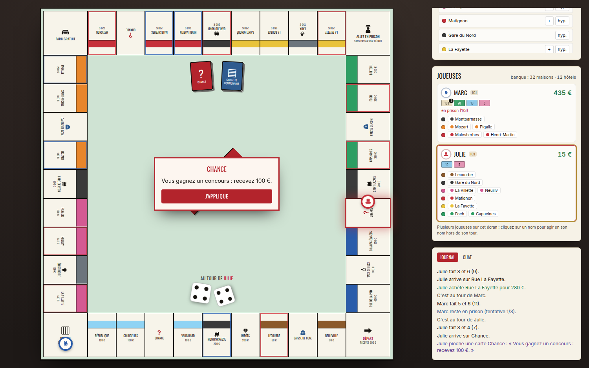

# JeuSociete — une ludothèque à jouer ensemble

Des jeux de société jouables depuis un navigateur, autour d'un même écran ou
chacun chez soi. Un seul serveur, une seule adresse : l'accueil présente les
boîtes, on dresse une table, on envoie le code — et l'on joue.

| jeu | adresse | joueurs | en deux mots |
|---|---|---|---|
| **Monopoly** | `/monopoly` | 2 – 8 | sept éditions, trois extensions Hasbro, quatre niveaux de bots |
| **Fantasy** (Les Sept Peuples) | `/sept-peuples` | 2 – 4 | jeu de cartes de petit peuple : pouvoirs, contres, familles |
| **Le Gabo** | `/gabo/` | 2 – 8 | jeu de cartes de mémoire et de réflexes, le plus petit total l'emporte |

Usage strictement privé, en famille et entre amis.

## Lancer

```bash
npm install
npm run build   # compile les interfaces — à refaire après chaque `git pull`
npm start       # http://localhost:3000 — l'adresse à partager s'affiche au démarrage
npm run check   # lint + tous les tests
```

Node 22 ou plus. Au démarrage, le serveur affiche aussi l'adresse locale
(`http://192.168.x.x:3000`) à donner aux autres sur le même wifi.

## Jouer ensemble, en permanence

Pour un lien qui tourne 24 h/24 sans dépendre d'un ordinateur allumé, le dépôt
contient un `render.yaml` prêt pour [Render](https://render.com) : « New » →
« Blueprint », ce dépôt, branche **`main`**. Il faut le plan **Starter** : le
plan gratuit met le service en veille et efface les parties sauvegardées à
chaque redémarrage (détails : `CLAUDE.md` §2 bis).

Chaque partie est sauvegardée à chaque coup. Fermer un onglet, verrouiller son
téléphone, redémarrer le serveur : on retrouve sa place en revenant.

## Les jeux

### Monopoly

Plateau, règles, temps réel, échanges, chat, reconnexion, jeu **sur le même
ordinateur** et **à distance** dans la même partie, en **français ou en
anglais**.

| édition | monnaie | particularité |
|---|---|---|
| **Classique** | € | la référence — vingt pions au choix |
| **Harry Potter — Gallions** | G | règles classiques, noms de Poudlard |
| **Marvel Avengers** | M$ | bases S.H.I.E.L.D. et quartiers généraux Stark |
| **Spider-Man — Collector** | $ | reskin exact du classique |
| **Spider-Man — Bouffon Vert** | $ | règles Hasbro : héros à pouvoirs, pion hostile, raccourcis de toile |
| **Harry Potter — Coupe des Quatre Maisons** | points | pas d'hôtel ni d'hypothèque, on gagne en explorant le plateau |
| **Mega Edition** | € | 52 cases, jusqu'à 8, troisième dé, tickets de bus, gratte-ciels |

Sur le classique, trois **extensions Hasbro** s'activent à la création de la
partie : **Parc Gratuit Jackpot**, **Prison**, **Tout Acheter** (l'écran grise
celles qui se marchent dessus).

Ce qui en fait une partie de famille plutôt qu'un jeu vidéo :

- **un loyer n'est jamais prélevé d'office** — on paie, on hypothèque, on
  négocie avec n'importe qui, ou l'on propose un arrangement à la
  propriétaire ; un bouton **Annuler** revient sur un geste réversible ;
- **aucune commande réservée** : on se met d'accord à l'oral, la première qui a
  la souris clique ;
- **quatre niveaux de bots** (facile, moyen, difficile, expert) qui achètent,
  bâtissent, enchérissent et négocient — sans jamais pouvoir tricher ;
- sur téléphone, le plateau et les boutons tiennent dans le même onglet ; sur
  ordinateur, les panneaux se rangent à gauche ou à droite du plateau.



### Fantasy — Les Sept Peuples

Sept peuples de huit cartes (elfes, korrigans, fées, lutins, farfadets, gnomes,
dryades), chacun avec son pouvoir ; les fées s'opposent aux pouvoirs adverses
et peuvent elles-mêmes être contrées. Mains cachées, variantes au choix, trois
niveaux de bots.

### Le Gabo

Quatre cartes face cachée devant soi, dont on n'a vu que deux. À son tour, on
pioche ou l'on prend la défausse pour remplacer une carte, ou l'on jette la
carte piochée pour son pouvoir (7-8 : regarder sa carte, 9-10 : celle d'une
autre, Valet-Dame : échanger à l'aveugle). Dès qu'une carte est jetée, chacun
peut **poser dessus une carte de même valeur** — la sienne, ou celle d'une
adversaire pour la pénaliser — d'un double toucher, de mémoire. Quand on se
croit à 5 points ou moins, on annonce « Gabo ».

52 cartes sans joker, de 2 à 8, bots à mémoire faillible, et une table qui ne
se bloque jamais (une absente joue en automatique, un bouton pour presser
l'étourdie).

## Organisation du dépôt

```
client/            l'interface de la ludothèque (React + Vite + Tailwind)
  src/Root.jsx     l'aiguillage : accueil, Monopoly ou Fantasy
  src/hub/         l'accueil et son étagère
  src/components/  Monopoly : plateau, actions, échanges, journal…
  src/peuples/     Fantasy
server/            le serveur (Node + Express + Socket.io)
  index.js         un seul processus, un seul port, pour toute la ludothèque
  games/           le catalogue des jeux branchés sur les sockets communs
  engine/          moteur du Monopoly ;  bots/  ses joueuses artificielles
shared/            données du Monopoly (éditions, cartes) et de Fantasy
gabo/              le Gabo, autonome : engine/ · server/ · client/
tests/             un fichier par jeu et par sujet
scripts/           tournois et réglage des bots du Monopoly
docs/              documentation détaillée (voir docs/README.md)
CLAUDE.md          le carnet de bord : architecture, décisions, pièges, suite
```

Le principe commun aux trois jeux : **le serveur fait foi**. Le navigateur
n'applique aucune règle ; il affiche ce qu'on a le droit de voir et envoie des
intentions. Dans les jeux à cartes cachées, chaque poste ne reçoit que sa
propre vue — un navigateur modifié n'apprendrait rien de plus.
